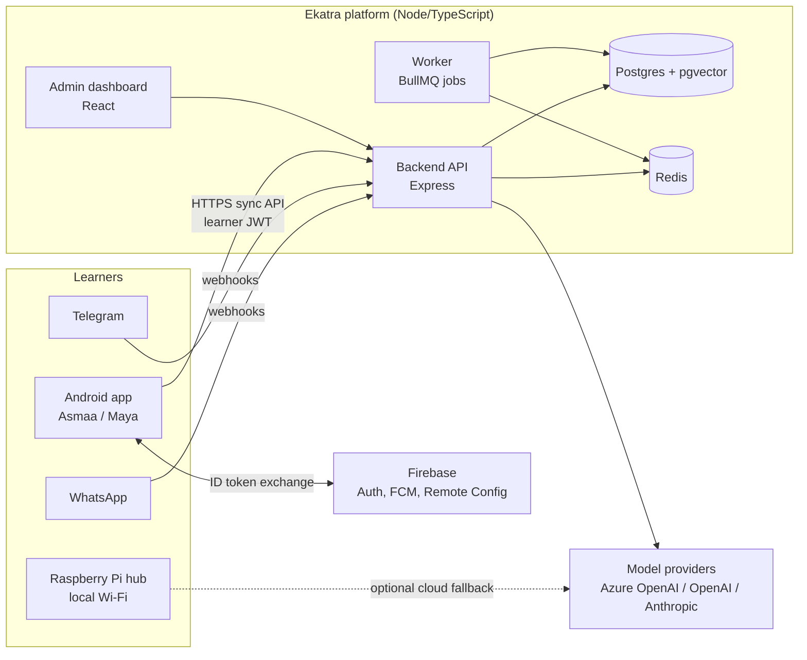
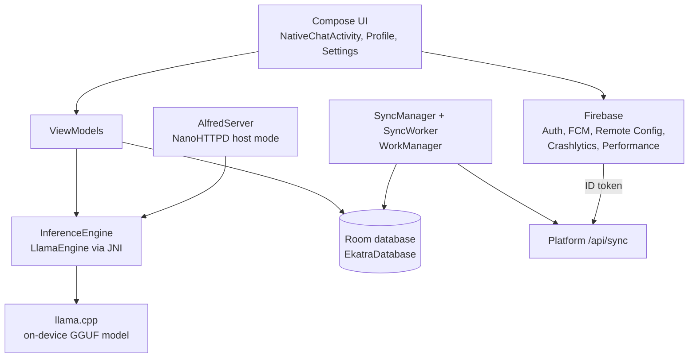
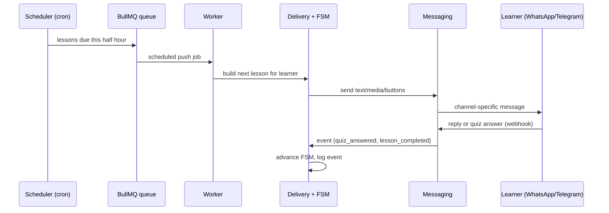

# Ekatra Technical Architecture

Ekatra delivers AI-assisted micro-learning to people on the channels and devices they already have: WhatsApp, Telegram, Android phones that work offline, and a Raspberry Pi that serves a whole classroom over local Wi-Fi.

This document explains how the pieces fit together, how each one is built, and where to start if you want to run, change, or learn from it.

- Status: drawn from the code as of 2026-11-01.
- Diagrams use [Mermaid](https://mermaid.js.org/), which GitHub renders.

---

## 1. The system at a glance



Four deliverables, one core idea: **the platform is the engine and source of truth for courses**; the clients differ in how they reach a learner.

| Deliverable | What it is | Talks to platform? |
|---|---|---|
| **Platform** | Backend, worker, admin dashboard, shared packages | n/a (it is the platform) |
| **Android apps** (Asmaa, Maya) | Offline-first app with an on-device LLM; syncs lessons and progress when online | Yes, via `/api/sync/*` |
| **Offline hub** | Python server on a Raspberry Pi giving a classroom an AI tutor and Kolibri content over a local hotspot | No by default; optional cloud AI fallback |
| **MicroLearn** | A separate product: WhatsApp-delivered enterprise learning on Supabase | No (separate stack) |

---

## 2. Platform

A pnpm TypeScript monorepo.

```
apps/
  backend/    Express API, conversation FSM, schedulers, webhooks
  frontend/   React + Vite admin dashboard
  worker/     Background jobs (BullMQ)
packages/
  database/   Postgres schema, 17 SQL migrations, repositories, seed
  delivery/   Lesson delivery, schedule timing, certificates, model router
  messaging/  Channel-agnostic send layer (WhatsApp, Telegram, ...)
  shared/     Shared types and utilities
```

Local infrastructure is `docker-compose.yml`: `pgvector/pgvector:pg16`, `redis:7`, a one-shot `migrate` service, then `backend`, `frontend` and `worker`.

### 3.1 Request paths

Public (no staff login): `/api/webhooks` (WhatsApp and Telegram inbound), `/api/auth` and `/api/auth/whatsapp` (OTP sign-in), `/api/certificates`, `/api/sync` (Android).

Staff-only (JWT middleware): `/api/courses`, `/api/learners`, `/api/schedules`, `/api/users`, `/api/fsm`, `/api/admin`, analytics.

All `/api` traffic is rate limited. Webhooks verify signatures (`middleware/webhookSecurity.ts`), and inbound receipts are stored so failed handling can be retried (`webhookRecovery`, migration 010).

### 3.2 Conversation engine (the FSM)

`apps/backend/src/flows/conversationFSM.ts` drives every learner conversation: onboarding, course selection or generation, lesson delivery, quizzes, and Q&A. Courses can also be authored as a finite state machine stored in Postgres (`fsm_definitions`, migration 007) and edited visually in the admin **FSM Editor**. Enrollments link to a definition (migration 008).

Node types seen in the code: `text`, `button`, `interactive`, `screen`, `image`, `video`, `audio`, `review`, `end`. Transitions fire on events such as `quiz_answered` and `lesson_completed`.

Authored courses (for example from a spreadsheet) are compiled into this FSM format by a CSV-to-FSM compiler and imported with a CLI (`importAuthoredCourse`), so hand-authored and AI-generated courses run on the same delivery path.

### 3.3 Channels

`packages/messaging` exposes one send call. Learners are addressed by a channel-tagged id: `tg:<chat_id>` routes to Telegram; a phone number routes to WhatsApp. The WhatsApp provider is chosen by configuration (`WHATSAPP_PROVIDER` / `MESSAGING_PROVIDER`): Meta Cloud API by default, with Twilio and a mock provider for testing. Business logic never sees the channel, so adding a channel means implementing one provider interface.

`lib/whatsappFormatter.ts` adapts content to WhatsApp limits (3 reply buttons, list messages, character caps).

### 3.4 AI layer

`packages/delivery/src/lib/modelRouter.ts` is the single entry point for generation:

- **Text tiers** `auto` (Azure's model-router picks the cheapest capable model), `best`, `mini`.
- **Image** generation (default `gpt-image-1`), **speech** synthesis (Azure Speech), **transcription**, with video a stub until a deployment exists.
- Capabilities degrade gracefully; callers check availability per task.

Other pieces: `courseGenerator` (AI course creation), `qaService` (Socratic tutor with retrieval over pgvector), `courseImages` and `lessonMedia`, and `fsrs.ts` (spaced-repetition scheduling for flashcards). There are also Anthropic, OpenAI and Meta model clients for fallback and experiments.

### 3.5 Scheduling and background work

- `node-cron` ticks every 30 minutes (due lesson pushes) and daily at 09:00.
- BullMQ queues on Redis (`scheduledPush`, `flashcardReminder`) are processed by `apps/worker`, with a dead-letter path for repeated failures (migration 006).
- Send results carry a `permanent` flag so non-retryable failures (such as an invalid Telegram address) skip retries.

### 3.6 Data model (Postgres)

Created by the SQL migrations in `packages/database/src/migrations`. Highlights: learners and enrollments, courses and FSM definitions, message log, flashcards, content cache, `learner_events` (with sync fields), lesson media, OTP challenges and events, learner channel addresses, webhook receipts.

### 3.7 Learner identity, auth, privacy

- **Staff** sign in with email and password (JWT).
- **Learners on the app** sign in with Firebase (Google, email, or WhatsApp OTP). The app sends the Firebase ID token to `POST /api/sync/auth/exchange`; the backend verifies it with Firebase Admin and returns a **learner JWT** used for all sync calls (`middleware/learnerAuth.ts`).
- **WhatsApp OTP** (`routes/authWhatsapp.ts`, `services/whatsappOtp.ts`) has per-number and global limits and escalating lockouts.
- **Account deletion** is a shared service (`accountDeletion.ts`) behind `DELETE /api/sync/me` and token-based `POST /api/sync/auth/account/delete`, removing learner data and orphaned AI-generated courses the learner owned.

### 3.8 Sync API (Android contract)

| Endpoint | Purpose |
|---|---|
| `POST /api/sync/auth/exchange` | Firebase ID token for learner JWT |
| `GET /api/sync/me` | Learner profile |
| `POST /api/sync/lessons/request` | Ask for the next lesson (idempotent) |
| `GET /api/sync/courses/:courseId/bundle` | Download a course for offline use |
| `GET /api/sync/media/:id` | Fetch lesson media |
| `POST /api/sync/events` | Upload progress and quiz events |
| `DELETE /api/sync/me`, `POST /api/sync/auth/account/delete` | Account deletion |

Each route is rate limited per learner.

### 3.9 Configuration

Everything is environment variables; see `.env.example`. Groups: database and Redis, JWT, messaging provider and Meta credentials, model providers (Azure OpenAI, OpenAI, Anthropic, Google, ElevenLabs), Telegram bot token, Firebase service account, OTP provider. Secrets must never be committed.

---

## 3. Android apps (Asmaa and Maya)

One Kotlin codebase (package `org.ekatra.alfred`), two **product flavors** in the `persona` dimension:

| Flavor | applicationId | Audience |
|---|---|---|
| `asmaa` | `org.ekatra.asmaa` | Arabic |
| `maya` | `org.ekatra.alfred` | General purpose |

Flavor-specific resources and `google-services.json` live in `app/src/asmaa` and `app/src/maya`; `Persona.kt` carries persona behaviour.



Key components:

- **On-device inference:** `LlamaEngine` calls llama.cpp through JNI (`llama_jni.cpp`, CMake build). Models are downloaded on first use by `ModelDownloadWorker` and checked by `ModelVerifier`. Weights are **not** in git; see the repo README for where to get them.
- **Local storage:** Room database (schema v4) for chat, profile and downloaded course content.
- **Sync:** `SyncManager` and `SyncWorker` upload events and pull course bundles when online, so lessons work with no connection.
- **Host mode:** `AlfredServer` (NanoHTTPD) lets one phone serve the model to nearby devices over its own Wi-Fi.
- **Safety and tooling:** `MathInterceptor` handles arithmetic deterministically instead of leaving it to a small model; `ConsentManager` and `AccountDeleter` implement consent and in-app deletion; `RemoteConfigManager` and `AppUpdateChecker` handle remote settings and updates.
- **Build:** Gradle Kotlin DSL, Jetpack Compose, Hilt-style modules in `di/`. Release signing keystores are kept outside the repo.

`lib/llama.cpp` is a git submodule pointer; clone with `--recurse-submodules` once `.gitmodules` is restored.

---

## 4. Offline hub (Raspberry Pi)

A Python server for places with no internet. A Pi creates a Wi-Fi hotspot; learners connect with any phone and open a web page.

- **Entrypoints:** `server.py` is the maintained runtime; `lightweight_server.py` is the Pi and tunnel variant. `main.py`, `main_v2.py` and `main_react.py` are legacy wrappers.
- **Modules in `src/`:** `model_manager` (local model), `wifi_manager` (hotspot), `network_discovery_v2`, `system_monitor`, and `azure_ai` (optional cloud fallback).
- **Content:** Kolibri offline content, installed with `install_kolibri_pi.sh` and flashed to SD with `flash_kolibri_sd.sh`.
- **Operations:** `setup.sh`, `start.sh`, `restart.sh`, `status.sh`, `deploy_to_pi.sh`, `find_pi.sh`.
- **Design choices:** a small local model for the tutor, a lightweight server for Pi Zero class hardware, and an optional tunnel when a cloud connection is available.

Today it is standalone; syncing it with the platform (courses in, progress out) would reuse the same sync API the Android app uses.

---

## 5. MicroLearn (separate product)

A Lovable-built web app with Supabase as the backend; **not** part of the platform codebase.

- **Frontend:** TanStack Start and Router, React Query, Tailwind. Staff portal for courses, learners, chat history, WhatsApp and Telegram settings.
- **Backend:** Supabase Postgres (12 migrations), Auth, and edge functions: `whatsapp-webhook`, `whatsapp-api`, `whatsapp-template-monitor`, `telegram-webhook`, `ai-tutor`, `generate-embedding`, `find-similar-resources`, `admin-user-management`, `demo-auth`.
- **AI:** Lovable AI for the tutor and embeddings.

It overlaps the platform in features (WhatsApp delivery, tutor, course editor) but shares no code. A longer-term decision is whether its admin UI becomes a front end over the platform.

---

## 6. How a lesson reaches a learner



On Android the same lesson is pulled as a bundle through `/api/sync/courses/:id/bundle`, played locally, and progress events are posted back to `/api/sync/events`.

---

## 7. Running it

| Piece | Start here |
|---|---|
| Platform | `cp .env.example .env`, fill in values, `docker compose up` (Postgres, Redis, migrations, backend, frontend, worker) |
| Android | Open in Android Studio; add your own Firebase `google-services.json` per flavor; `./gradlew assembleMayaDebug` or `assembleAsmaaDebug` |
| Offline hub | `./setup.sh`, copy `.env.example` to `.env`, `./start.sh` |
| MicroLearn | Lovable project plus a Supabase project; apply migrations and deploy edge functions |

Verify these commands against each repo's README before publishing; they reflect the current layout, not a tested walkthrough.

---

## 8. Security notes for contributors

- Never commit `.env` files, service accounts, signing keystores, or tokens. Each repo ships a `.env.example` with placeholders only.
- Public repos are published as clean snapshots without history.
- The Android apps ship consent, in-app account deletion, and per-learner rate limits; see the Android `SECURITY_AUDIT.md` and the platform hardening docs.

## 9. Known gaps

- The Android `lib/llama.cpp` submodule needs its `.gitmodules` restored.
- The offline hub has several legacy entrypoints pending removal and does not yet sync with the platform.
- Video generation is not implemented in the model router.
- Run commands in section 7 were not executed end to end while writing this document.
